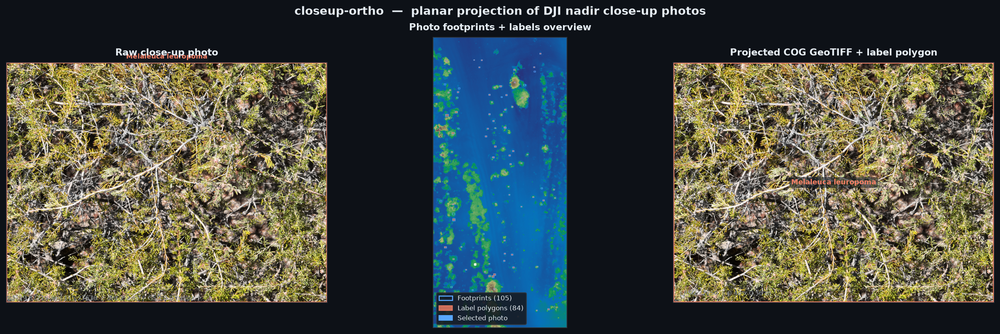
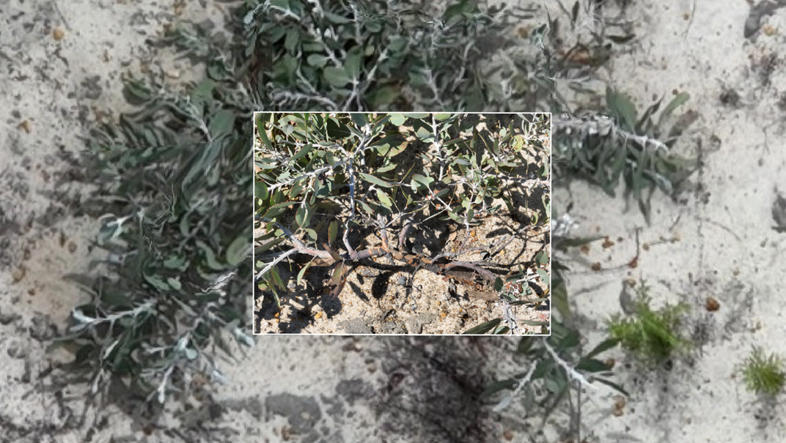

# 🌿 closeup-ortho

**Orthorectify DJI nadir close-up drone photos and project Labelbox annotations to ground coordinates.**



*Left: raw close-up photo with Labelbox bounding box. Centre: all 105 photo footprints over the DSM, with 84 projected label polygons (red). Right: the same photo georeferenced as a COG GeoTIFF with its label polygon in the DSM CRS.*

---

## What it does

`closeup-ortho` performs a **simple planar projection** of DJI nadir close-up photos onto a DSM. Each photo is placed on the ground as a rectangle whose:

- 📍 **position** comes from the RTK GPS of the **wide** frame (WGS84 lat/lon). Tele/med frames store the *planned* waypoint coordinates instead of the actual RTK fix, so their footprints borrow the position (and altitude) of the wide frame taken at the same waypoint; the photo's own gimbal angles are kept.
- 🧭 **heading** comes from the gimbal yaw
- 📐 **size** comes from the camera-to-ground distance — `AbsoluteAltitude − max(DSM elevation in a small buffer)` — combined with the lens geometry (calibrated focal length for the wide camera, `FocalLengthIn35mmFilm` for the tele camera)

It assumes photos are taken straight down (gimbal pitch ≈ −90°) and that the DSM uses **ellipsoidal heights**, matching the drone's `AbsoluteAltitude`. All outputs are in the **CRS of the input DSM**.

Three commands:

| Command | What it does |
|---|---|
| `orthorectify` | Projects photos onto a DSM → GeoPackage footprint polygons + optional COG GeoTIFFs |
| `batch` | Runs `orthorectify` for a list of missions (each with its own DSM) → one combined GeoPackage |
| `labels` | Reprojects Labelbox bounding-box annotations to ground coordinates, linked to footprints |

### Example output in QGIS



*A single georeferenced close-up photo (COG GeoTIFF) with its projected label polygon, displayed in QGIS over the DSM.*

---

## 🛠 Install

```bash
python -m venv .venv

# Windows
.venv\Scripts\python -m pip install -e .

# macOS / Linux
.venv/bin/python -m pip install -e .
```

**Dependencies:** `rasterio`, `geopandas`, `pyproj`, `shapely`, `numpy`, `Pillow`

---

## 🚀 Usage

### 1 — Project photos onto the DSM

```bash
closeup-ortho orthorectify \
  --photos   data/examples/enearehab1/closeup/20260127_enearehab1_wpt169_m3e \
  --dsm      data/examples/enearehab1/dsm/20260225_enearehab1_10m169_m3e_aoi.tif \
  --out      out/examples/enearehab1/footprints.gpkg \
  --geotiffs out/examples/enearehab1/tiff
```

| Option | Default | Description |
|---|---|---|
| `--lenses` | `tele` | Which lenses to process: `tele`, `wide`, `tele,wide`, or `all` |
| `--geotiffs DIR` | — | Also write projected COG GeoTIFFs to this folder |
| `--buffer-radius M` | auto | DSM sampling buffer radius in meters (default: ~50–75 cm) |
| `--no-recursive` | — | Scan only the top folder, not subfolders |

```python
from closeup_ortho import orthorectify_folder

gdf = orthorectify_folder(
    photo_dir="data/examples/enearehab1/closeup/20260127_enearehab1_wpt169_m3e",
    dsm_path="data/examples/enearehab1/dsm/20260225_enearehab1_10m169_m3e_aoi.tif",
    out_gpkg="out/examples/enearehab1/footprints.gpkg",
    lenses={"tele"},
    write_geotiffs=True,
    geotiff_dir="out/examples/enearehab1/tiff",
)
```

### 2 — Batch: several missions into one GeoPackage

Process a list of close-up missions, each against its own DSM, and write all footprints
to a single `footprints` layer. The link between a close-up (`wpt`) mission and the
photogrammetry mission whose DSM to use is made **manually**, in a small text file of
`closeup_mission,photogrammetry_mission` pairs (one per line, `#` comments allowed):

```
# missions.txt
20260127_enearehab1_wpt169_m3e,20260225_enearehab1_10m169_m3e
20260129_enearehab1_wpt170_m3e,20260225_enearehab1_10m169_m3e
```

```bash
closeup-ortho batch \
  --missions missions.txt \
  --out      out/footprints.gpkg
```

Photos are found at `<photos-root>/<yyyy>/<closeup_mission>/` and the DSM at
`<dsm-root>/<yyyy>/<pg_mission>/<pg_mission>_dsm.cog.tif` (falling back to `_dsm.tif`),
with the year taken from the mission name. Every pair is resolved before any processing
starts, so a typo fails immediately.

| Option | Default | Description |
|---|---|---|
| `--photos-root` | `/mnt/nfs/lefodata/data/drone_missions` | Root of the drone-mission photo tree |
| `--dsm-root` | `/mnt/nfs/conrad/labolaliberte_data/metashape` | Root of the Metashape product tree |
| `--lenses`, `--geotiffs`, `--buffer-radius`, `--no-recursive` | | Same as `orthorectify`; GeoTIFFs go under `<dir>/<closeup_mission>/` |

The combined layer has the same columns as `footprints` plus `mission`,
`photogrammetry_mission`, and `dsm`. All missions must share the DSM CRS (same UTM
zone) — the label reprojection relies on meter-based footprint attributes, so the tool
refuses to mix CRSs in one layer rather than silently reproject.

```python
from closeup_ortho import orthorectify_missions, read_mission_pairs

gdf = orthorectify_missions(
    read_mission_pairs("missions.txt"),
    out_gpkg="out/footprints.gpkg",
)
```

### 3 — Project Labelbox annotations

```bash
closeup-ortho labels \
  --ndjson     "data/examples/enearehab1/labelbox/2025_wa_roberge - 6_12_2026.ndjson" \
  --footprints out/examples/enearehab1/footprints.gpkg \
  --out        out/examples/enearehab1/labels.gpkg
```

```python
from closeup_ortho import project_labels

gdf = project_labels(
    ndjson_path="data/examples/enearehab1/labelbox/2025_wa_roberge - 6_12_2026.ndjson",
    footprints_gpkg="out/examples/enearehab1/footprints.gpkg",
    out_gpkg="out/examples/enearehab1/labels.gpkg",
)
```

The output layer contains one polygon per bounding box. Join it back to footprints via `footprint_filename` → `filename`.

---

## 📦 Output layers

### `footprints` — one polygon per photo

| Column | Description |
|---|---|
| `path` | Full path to the photo |
| `filename` | Filename with extension |
| `directory` | Parent directory of the photo |
| `camera` | `tele`, `wide` or `med` (`med` = middle camera of the DJI M4E) |
| `longitude`, `latitude` | Camera position, WGS84 (from the paired wide frame for tele/med) |
| `abs_alt_m` | AbsoluteAltitude (ellipsoidal), meters (from the paired wide frame for tele/med) |
| `position_source` | `wide` (borrowed from the paired wide frame) or `self` (photo's own tags — no wide sibling found, or the wide nav record was implausible) |
| `position_from` | Filename of the wide frame the position came from (empty for wide photos) |
| `dist_m` | Camera-to-ground distance used for projection, meters |
| `gsd_m` | Ground sample distance, meters/pixel |
| `footprint_w_m`, `footprint_h_m` | Footprint dimensions on the ground, meters |
| `yaw`, `pitch`, `roll` | Gimbal angles, degrees |
| `nadir_ok` | Gimbal within nadir tolerance |
| `focal_source` | `calib` (wide camera's CalibratedFocalLength) or `fl35` (FocalLengthIn35mmFilm) |
| `timestamp` | Capture time |

### `labels` — one polygon per bounding box

| Column | Description |
|---|---|
| `footprint_filename` | 🔑 Foreign key → `filename` in the footprints layer |
| `datarow_id` | Labelbox data row ID |
| `label_id` | Labelbox label ID |
| `feature_id` | Labelbox feature ID for this bounding box |
| `url` | Full URL of the source JPEG on the object store |
| `object_name` | Annotation class name (e.g. `Plants`) |
| `object_value` | Annotation class value (e.g. `plants`) |
| `taxon_name` | Taxon name from the radio classification |
| `taxon_value` | Taxon ID (PlantNet ID) |
| `bbox_top_px`, `bbox_left_px`, `bbox_height_px`, `bbox_width_px` | Original bbox in image pixels |
| `dataset_name` | Labelbox dataset name |
| `project_name` | Labelbox project name |
| `workflow_status` | Labelbox workflow status (e.g. `IN_REVIEW`, `TO_LABEL`) |
| `label_created_by` | Annotator email |
| `label_created_at` | Annotation timestamp |
| `lb_created_by` | Data row creator email |

---

## 🔭 Not yet implemented

- Using the **Matrice 4 Enterprise laser rangefinder** for the distance term (currently DSM-derived for all drones)
- Handling photos that fall **outside the DSM extent** (currently skipped with a warning)
